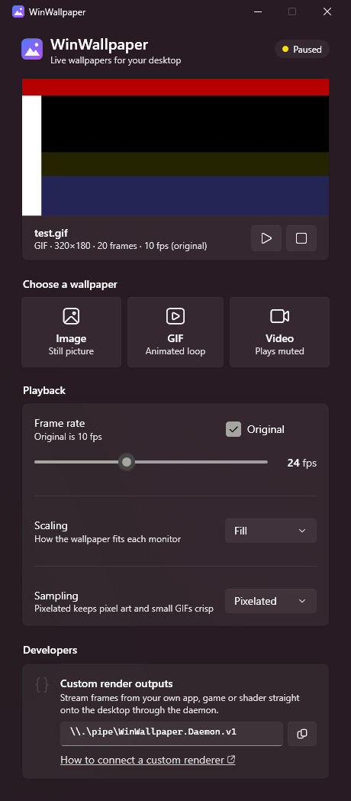
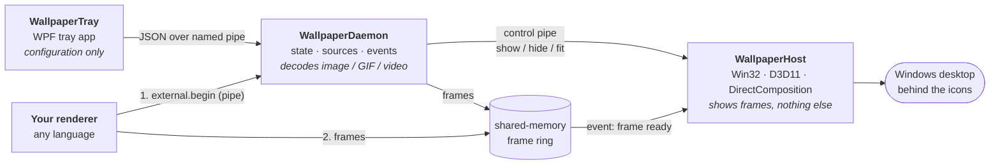

# WinWallpaper

**Live wallpapers for Windows 11: images, GIFs, videos, and anything your own code can draw.**

> [!WARNING]
> **Very early development.** This is a working proof of concept, not a product. Expect
> breaking changes to the code, the pipe API and the frame protocol, rough edges and
> missing features. Builds are unsigned pre-releases, so SmartScreen will warn.
> Tested on one machine: Windows 11 build 26200, NVIDIA GPU, two monitors.

<p align="center"></p>

## What it does

- Draws behind your desktop icons on every monitor. Icons, right-click and Win+D keep working.
- Plays still **images**, animated **GIFs** and **videos** (looped, muted), with a custom frame rate for GIFs and video.
- Scaling per monitor (Fill / Fit / Stretch / Center), plus Smooth or Pixelated sampling for pixel art.
- Lets **any app stream its own frames** to the desktop: games, dashboards, generative art, a clock.
- Costs nothing when nothing moves: a static wallpaper uses 0 % CPU, and the processes block on events instead of polling.
- Survives Explorer restarts and display changes, and remembers your wallpaper.

## Architecture

Three small processes, each with one job:



| Component | Owns | Doesn't know about |
|---|---|---|
| **WallpaperHost** | One window per monitor parented into Explorer's desktop, D3D11 swap chains, GPU scaling via DirectComposition, recovery when Explorer restarts | Files, GIFs, video, schedules, other apps |
| **WallpaperDaemon** | What is playing and why, decoding (WIC, Media Foundation), playback timing, who may draw (writer tokens), saved state, the public pipe API | Windows, GPUs, monitors |
| **WallpaperTray** | The UI: file pickers, frame rate, scaling, pause/stop | Rendering. Close it and the wallpaper keeps running |

**Design rules:** the renderer is dumb, the daemon owns state, the tray owns
configuration, the protocol is versioned, and everything is event-driven.

**How frames move:** whoever produces pixels (the daemon's decoders or your app) writes
them into a shared-memory ring and signals an event. The host wakes, copies the frame
to the GPU and presents it. The daemon never copies an external app's pixels; it only
decides *whose* frames the host accepts.

Want the details? [docs/architecture.md](docs/architecture.md) has the design and
measurements, and [docs/desktop-integration.md](docs/desktop-integration.md) explains how
drawing behind the desktop icons works on Windows 11 (24H2+), with spike results.

## Write your own renderer

Anything that can open a named pipe and a memory-mapped file can drive the wallpaper. In C#:

```csharp
using WallpaperProtocol;

using var output = await ExternalOutput.ConnectAsync("My Renderer"); // take the wallpaper
var pixels = new byte[1920 * 1080 * 4];                             // BGRA8, top-down

while (!output.Revoked)                  // becomes true if the user picks another wallpaper
{
    DrawSomething(pixels);
    output.Submit(pixels, 1920, 1080);   // the host scales it to every monitor
    await Task.Delay(33);                // your pace; publish only when something changed
}
// Disposing hands the wallpaper back: the previous one returns automatically.
```

The protocol in one paragraph: send `{"cmd":"external.begin","name":"…"}` to
`\\.\pipe\WinWallpaper.Daemon.v1` and keep the pipe open. You get a `writer` token.
Write a frame into slot `seq % 3` of `Local\WinWallpaper.Frames.v1`, fill in the
64-byte header with your token, bump `seq`, and set `Local\WinWallpaper.FrameReady.v1`.
That's all.

**Samples** (start the tray app first so the daemon is running):

| Sample | Run it |
|---|---|
| Digital clock over your own background image, optional seconds | `dotnet run --project samples/ClockRenderer -- --background "C:\Pictures\photo.jpg" --seconds` |
| Animated plasma | `dotnet run --project samples/ExternalRenderer -- --seconds 20` |
| Raw protocol, no SDK (Python standard library) | `python samples/python/color_cycle.py 10` |

**Full guide:** [docs/custom-render-outputs.md](docs/custom-render-outputs.md) covers the
byte layout, lifecycle and revocation, all pipe commands, and troubleshooting.

## Getting started

### Install a build

Download `WinWallpaper-<version>-x64.msi` from the GitHub Releases page (tagged
pre-releases), or from the artifacts of any CI run. It installs per user, so there's
no admin prompt. You get a Start menu entry, and the tray starts at sign-in. Uninstall
from Settings → Apps. A portable `.zip` of the same files is published next to it.

### Build from source

**You need:** Windows 11 and the [.NET 10 SDK](https://dotnet.microsoft.com/download).
Python 3 only for the Python sample.

```bash
git clone <this repo>
cd WinWallpaperManager
dotnet build WinWallpaperManager.slnx
```

Run the tray app. It starts the daemon, which starts the host:

```bash
artifacts/bin/Debug/WallpaperTray.exe
```

Pick an image, GIF or video. Closing the window keeps it in the tray. Right-click the
tray icon and choose **Quit WinWallpaper** to stop everything and get your normal
wallpaper back.

Need test media? `dotnet run --project tests/tools/MakeTestMedia -- tests/media`
writes a test GIF and MP4.

Something wrong? Logs are in `%LOCALAPPDATA%\WinWallpaper\logs\` and saved state is
in `%LOCALAPPDATA%\WinWallpaper\state.json`.

### Package it yourself

```powershell
./build/publish.ps1 -Version 0.1.0 -Msi   # app folder + artifacts/installer/WinWallpaper-0.1.0-x64.msi
./build/smoke.ps1                         # drive the published daemon end to end
```

- `WallpaperHost` and `WallpaperDaemon` are published as **Native AOT** (about 4 MB each,
  no runtime needed). `WallpaperTray` is WPF, which can't be AOT-compiled, so it ships
  **self-contained**. That's why the MSI is about 60 MB.
- Native AOT needs the Visual Studio C++ build tools. The script finds them through `vswhere`.
- The installer is a [WiX v5](https://wixtoolset.org) project (`installer/`). It builds with
  `dotnet build`; nothing else to install.

### CI and releases

[`.github/workflows/ci.yml`](.github/workflows/ci.yml) runs on every push and pull request:
build the solution → publish → **smoke-test the published app** → build the MSI → upload
the MSI and a portable zip as artifacts. Pushing a tag creates a GitHub pre-release with
both files:

```bash
git tag v0.2.0
git push origin v0.2.0
```

Untagged CI builds are versioned `0.1.<run number>`.

## Repository layout

| Path | What |
|---|---|
| `src/WallpaperProtocol` | Shared names, frame ring, JSON pipe, `ExternalOutput` client: **start here if you write a renderer** |
| `src/WallpaperHost` | Desktop attachment and presentation |
| `src/WallpaperDaemon` | State, sources (`Sources/`), pipe API |
| `src/WallpaperTray` | WPF tray app (Fluent theme) |
| `samples/` | Custom renderers: clock, plasma, Python |
| `tests/spikes/DesktopAttach` | Research spike: desktop attach, hang tests, frame transports, GPU fences |
| `tests/tools/MakeTestMedia` | Generates deterministic test media |
| `build/` | `publish.ps1` (app folder + MSI), `smoke.ps1` (end-to-end check), `make-icon.ps1` |
| `installer/` | WiX v5 per-user MSI |
| `assets/` | App icon |
| `.github/workflows/` | CI and releases |
| `docs/` | Architecture, desktop integration, renderer guide |

## Status and known gaps

| Area | State |
|---|---|
| Images, GIFs, video, scaling, sampling, pause/stop | Working |
| Custom renderers (CPU frames) | Working, protocol v1 |
| Multi-monitor | Same wallpaper on all monitors. **Per-monitor wallpapers not yet** |
| Video decoding | Software decode, ~30 % of a core for 720p30. **GPU decode is next** |
| GPU frames for renderers (shared textures + fences) | Proven in the spike, not in protocol v1 yet |
| Events (lock, idle, game launched…) | Not started |
| Per-user MSI, auto-start at sign-in, CI, tagged pre-releases | Working. **Not code-signed yet** |
| Windows 11 23H2 and older, mixed-DPI monitors, monitor hot-plug | Code paths exist but are untested |

## Contributing

It's early, so the best contributions right now are **trying it** and filing issues
(include your Windows build, GPU and the logs), and **writing renderers** against the
protocol and reporting what's awkward before v1 settles.

No license has been chosen yet.
