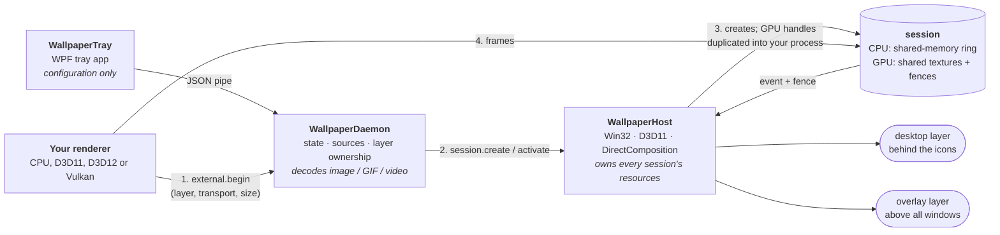

# WinWallpaper

**Live wallpapers for Windows 11: images, GIFs, videos, and anything your own code can draw.**

> [!WARNING]
> **Very early development.** This is a working proof of concept, not a product. Expect
> breaking changes to the code, the pipe API and the frame protocol, rough edges and
> missing features. Builds are unsigned pre-releases, so SmartScreen will warn.
> Tested on one machine: Windows 11 build 26200, NVIDIA GPU, two monitors.

<p align="center"></p>

## What it does

- Draws behind your desktop icons on every monitor. Icons, right-click and Win+D keep working.
- Plays still **images**, animated **GIFs** and **videos** (looped, muted), with a custom frame rate for GIFs and video.
- Scaling per monitor (Fill / Fit / Stretch / Center), plus Smooth or Pixelated sampling for pixel art.
- Lets **any app stream its own frames**: games, dashboards, generative art, a clock. Frames
  can go to the **desktop layer** (the wallpaper) or a click-through **overlay layer** above
  every window, from the **CPU** or straight from the **GPU** with Direct3D 11, Direct3D 12 or Vulkan.
- Costs nothing when nothing moves: a static wallpaper uses 0 % CPU, and the processes block on events instead of polling.
- Survives Explorer restarts and display changes, and remembers your wallpaper.

## Architecture

Three small processes, each with one job:



| Component | Owns | Doesn't know about |
|---|---|---|
| **WallpaperHost** | Per-monitor windows on two layers (desktop: parented into Explorer behind the icons; overlay: top-most, click-through), every session's shared memory, textures and fences, D3D11 + DirectComposition presentation, GPU scaling, Explorer-restart recovery | Files, GIFs, video, schedules, which app is which |
| **WallpaperDaemon** | What is on each layer and why, decoding (WIC, Media Foundation), playback timing, brokering sessions for apps, saved state, the public pipe API | Windows, GPUs, monitors |
| **WallpaperTray** | The UI: file pickers, frame rate, scaling, sampling, pause/stop, removing an overlay | Rendering. Close it and the wallpaper keeps running |

**Design rules:** the renderer is dumb, the daemon owns state, the tray owns
configuration, the protocol is versioned, and everything is event-driven.

**How frames move:** every producer (the daemon's own decoders or your app) gets a
**session** on one layer, and the host creates its resources. CPU sessions write rows into
shared memory. GPU sessions render into shared textures, signal a shared fence, and the
host's GPU waits on it before copying. No CPU copies, and no thread ever blocks on another
process. The daemon never touches an app's pixels; it only decides which session each layer
shows.

Want the details? [docs/architecture.md](docs/architecture.md) has the design and
measurements, and [docs/desktop-integration.md](docs/desktop-integration.md) explains how
drawing behind the desktop icons works on Windows 11 (24H2+), with spike results.

## Write your own renderer

When you connect, choose a **layer** and a **transport**:

| | CPU transport | GPU transport |
|---|---|---|
| **Desktop layer** (wallpaper, alpha ignored) | Write BGRA rows into shared memory. Any language | Render into shared textures with D3D11, D3D12 or Vulkan. No copies |
| **Overlay layer** (above all windows, click-through, premultiplied alpha) | Same, with transparency | Same, with transparency |

```csharp
using WallpaperProtocol;

using var session = await WallpaperSession.ConnectAsync(new SessionOptions
{
    Name = "My Renderer", Layer = Layer.Overlay, Transport = Transport.Cpu, Width = 1920, Height = 1080,
});
var pixels = new byte[1920 * 1080 * 4];          // BGRA8, top-down, premultiplied on the overlay
while (!session.Revoked)                          // true once the user or another app takes the layer
{
    DrawSomething(pixels);
    session.Cpu!.Submit(pixels);                  // the host scales it to every monitor
    await Task.Delay(33);                         // your pace; publish only when something changed
}
// Disposing ends the session: the overlay disappears / the user's wallpaper comes back.
```

For the GPU transport, add the helper for your API (`WallpaperProtocol.D3D11`, `.D3D12` or
`.Vulkan`). It opens or imports the host's textures and fences on your device and gives you
`BeginFrame()` / `EndFrame()`.

**Samples** (start the tray app first so the daemon is running):

| Sample | Run it |
|---|---|
| GPU: same scene in D3D11, D3D12 or Vulkan, either layer | `dotnet run --project samples/GpuRenderer -- --api vulkan --layer overlay` |
| Digital clock: wallpaper over your own image, or a floating overlay | `dotnet run --project samples/ClockRenderer -- --background "C:\Pictures\photo.jpg" --seconds`<br/>`dotnet run --project samples/ClockRenderer -- --overlay --seconds` |
| Animated plasma (CPU) | `dotnet run --project samples/ExternalRenderer -- --seconds 20` |
| Raw protocol, no SDK (Python standard library) | `python samples/python/color_cycle.py 10 --overlay` |

**Full guide:** [docs/custom-render-outputs.md](docs/custom-render-outputs.md) covers the
protocol byte by byte, GPU import for each API, lifecycle and revocation, all pipe
commands, and troubleshooting.

## Getting started

### Install a build

Download `WinWallpaper-<version>-x64.msi` from the GitHub Releases page (tagged
pre-releases), or from the artifacts of any CI run. It installs per user, so there's
no admin prompt. You get a Start menu entry, and the tray starts at sign-in. Uninstall
from Settings → Apps. A portable `.zip` of the same files is published next to it.

### Build from source

**You need:** Windows 11 and the [.NET 10 SDK](https://dotnet.microsoft.com/download).
Python 3 only for the Python sample.

```bash
git clone <this repo>
cd WinWallpaperManager
dotnet build WinWallpaperManager.slnx
```

Run the tray app. It starts the daemon, which starts the host:

```bash
artifacts/bin/Debug/WallpaperTray.exe
```

Pick an image, GIF or video. Closing the window keeps it in the tray. Right-click the
tray icon and choose **Quit WinWallpaper** to stop everything and get your normal
wallpaper back.

Need test media? `dotnet run --project tests/tools/MakeTestMedia -- tests/media`
writes a test GIF and MP4.

Something wrong? Logs are in `%LOCALAPPDATA%\WinWallpaper\logs\` and saved state is
in `%LOCALAPPDATA%\WinWallpaper\state.json`.

### Package it yourself

```powershell
./build/publish.ps1 -Version 0.1.0 -Msi   # app folder + artifacts/installer/WinWallpaper-0.1.0-x64.msi
./build/smoke.ps1                         # drive the published daemon end to end
```

- `WallpaperHost` and `WallpaperDaemon` are published as **Native AOT** (about 4 MB each,
  no runtime needed). `WallpaperTray` is WPF, which can't be AOT-compiled, so it ships
  **self-contained**. That's why the MSI is about 60 MB.
- Native AOT needs the Visual Studio C++ build tools. The script finds them through `vswhere`.
- The installer is a [WiX v5](https://wixtoolset.org) project (`installer/`). It builds with
  `dotnet build`; nothing else to install.

### CI and releases

[`.github/workflows/ci.yml`](.github/workflows/ci.yml) runs on every push and pull request:
build the solution → publish → **smoke-test the published app** → build the MSI → upload
the MSI and a portable zip as artifacts. Pushing a tag creates a GitHub pre-release with
both files:

```bash
git tag v0.2.0
git push origin v0.2.0
```

Untagged CI builds are versioned `0.1.<run number>`.

## Repository layout

| Path | What |
|---|---|
| `src/WallpaperProtocol` | Protocol v2: `WallpaperSession` client, session map, JSON pipe. **Start here if you write a renderer** |
| `src/WallpaperProtocol.D3D11` / `.D3D12` / `.Vulkan` | GPU transport helpers: open/import the host's shared textures and fences |
| `src/WallpaperHost` | Desktop attachment and presentation |
| `src/WallpaperDaemon` | State, sources (`Sources/`), pipe API |
| `src/WallpaperTray` | WPF tray app (Fluent theme) |
| `samples/` | Custom renderers: GPU (D3D11 / D3D12 / Vulkan), clock, plasma, Python |
| `tests/spikes/DesktopAttach` | Research spike: desktop attach, hang tests, frame transports, GPU fences |
| `tests/tools/MakeTestMedia` | Generates deterministic test media |
| `build/` | `publish.ps1` (app folder + MSI), `smoke.ps1` (end-to-end check), `make-icon.ps1` |
| `installer/` | WiX v5 per-user MSI |
| `assets/` | App icon |
| `.github/workflows/` | CI and releases |
| `docs/` | Architecture, desktop integration, renderer guide |

## Status and known gaps

| Area | State |
|---|---|
| Images, GIFs, video, scaling, sampling, pause/stop | Working |
| Custom renderers: desktop + overlay layers, CPU + GPU (D3D11 / D3D12 / Vulkan) | Working, protocol v2 |
| Multi-monitor | Same wallpaper on all monitors. **Per-monitor wallpapers not yet** |
| Video decoding | Hardware (GPU) decode: ~3 % of a core for 1080p30. CPU decode fallback (~75 %) when the GPU path isn't available |
| Events (lock, idle, game launched…) | Not started |
| Per-user MSI, auto-start at sign-in, CI, tagged pre-releases | Working. **Not code-signed yet** |
| Windows 11 23H2 and older, mixed-DPI monitors, monitor hot-plug | Code paths exist but are untested |

## Contributing

It's early, so the best contributions right now are **trying it** and filing issues
(include your Windows build, GPU and the logs), and **writing renderers** against the
protocol and reporting what's awkward before v1 settles.

No license has been chosen yet.
